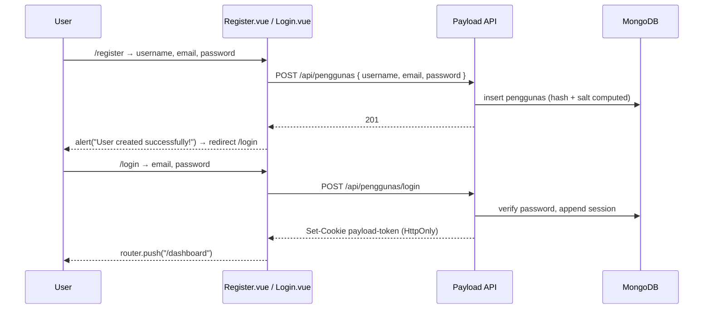

# Application Manual — "Aplikasi Chat Sederhana"

> This manual documents the application **as it currently exists**. Every command, route and configuration key below was verified against the committed source and the actual `package.json` scripts — nothing here is aspirational.

---

## 1. Purpose of the application

A simple Indonesian-language chat web application ("Aplikasi Chat Sederhana" — "Simple Chat Application") built as a full-stack portfolio piece. It provides:

- **Registration and login** for end users (the `penggunas` / "user" collection).
- **Channels** — named chat rooms any user can create and join.
- **Channel messages** — text messages inside a channel.
- **Direct messages** — 1:1 conversations between two users.
- **A Payload CMS Admin Panel** at `/admin` for the separate `users` collection.

Intended audience: the developer, and visitors of the public deployment.

---

## 2. Implemented features

### 2.1 Authentication

| Feature | Status | Where |
|---|---|---|
| Register with username + email + password | **Implemented** | `vue-frontend/src/components/Register.vue` → `POST /api/penggunas` |
| Login with email + password | **Implemented** | `vue-frontend/src/components/Login.vue` → `POST /api/penggunas/login` |
| Logout | **Implemented** | `vue-frontend/src/components/Dashboard.vue:131` → `POST /api/penggunas/logout` |
| Session persistence across page loads | **Implemented** (HttpOnly cookie) | Payload local auth + sessions |
| "Remember me" / refresh-token UI | **Not implemented** | — |
| Password reset / forgot password UI | **Implemented** | `ForgotPasswordView.vue` / `ResetPasswordView.vue` → `POST /api/penggunas/forgot-password` and `/reset-password`. Needs SMTP for real mail; without it the reset link is printed to the server console in non-production (`Penggunas.ts` `auth.forgotPassword`). |
| Email verification | **Deliberately disabled** | `penggunas.auth.verify = false` (B1) — registration is immediately usable. |
| Change password UI | **Not implemented** by design | Password recovery goes through the reset flow only (`Penggunas.ts` `beforeChange` guard). |
| Profile editing UI | **Not implemented** | — |
| Login with username (instead of email) | **Not implemented** | `loginWithUsername` is disabled |

### 2.2 Channels

| Feature | Status | Where |
|---|---|---|
| List all channels | **Implemented** | `Dashboard.vue:163`, `ChannelChatroom.vue:39` |
| List "your" channels (by membership) | **Implemented** | `Dashboard.vue:176` → `GET /api/memberships?where[pengguna_id][equals]=…` |
| Create a channel | **Implemented** | `Dashboard.vue:185`, `ChannelChatroom.vue:128` (also auto-joins the creator) |
| Join a channel | **Implemented** | `Dashboard.vue:214`, `ChannelChatroom.vue:111` |
| Leave a channel | **Not implemented** (no UI button) | — |
| Rename a channel | **Implemented but unreachable** | `Channel.vue:215` (legacy component, not routed) |
| Delete a channel | **Not implemented** (no UI) | Backend permits it for anyone |
| Channel description / topic | **Not implemented** | Only `channel_name` and `owner` exist |
| Private channels | **Not implemented** | — |

### 2.3 Channel messages

| Feature | Status | Where |
|---|---|---|
| View messages in a channel | **Implemented** | `ChannelChatroom.vue` `fetchMessages` — paginated (`limit=50`), auto-refreshed |
| Send a message | **Implemented** | `ChannelChatroom.vue` `sendMessage` |
| Auto-refresh (polling) | **Implemented** | Exponential backoff via `utils/polling.js` (3 s → 30 s cap), paused while the tab is hidden; "Load older messages" page control (B7) |
| Edit a message | **Not implemented** (no UI; backend permits it) | — |
| Delete a message | **Not implemented** (no UI; backend permits it) | — |
| Message reactions | **Not implemented** | — |
| Typing indicators | **Not implemented** | — |
| Read receipts | **Not implemented** | — |
| File/image attachments in messages | **Not implemented** | `media` collection exists but is not referenced by any message field |
| Search in messages | **Not implemented** | — |

### 2.4 Direct messages

| Feature | Status | Where |
|---|---|---|
| List other users | **Implemented (search-based)** | `Dashboard.vue` → `GET /api/penggunas/directory?q=…` — requires a search term; see note |
| Open a DM with a user | **Implemented** | `Dashboard.vue` → `/chat/:user_id` |
| View DM history | **Implemented** | `Chat.vue` `getMessages` — paginated (`limit=50`), auto-refreshed |
| Send a DM | **Implemented** | `Chat.vue` `sendMessage` |
| Auto-refresh (polling) | **Implemented** | Exponential backoff via `utils/polling.js` (4 s → 30 s cap), paused while the tab is hidden; "Load older messages" control (B7) |
| DM list / conversation list | **Implemented** | Sidebar "Direct messages" section (`AppSidebar.vue` + `stores/chat.js` `loadConversations`) — distinct participants from the caller's own `chats`, each with avatar, username and last-message preview |
| Edit / delete a DM | **Not implemented** (no UI; backend permits it) | — |

> Note: `Dashboard.vue` finds chat partners through the **search-based** directory endpoint
> `GET /api/penggunas/directory?q=<term>` (minimum 2 characters, paginated, email-free) — it no
> longer lists every registered user. There is no server-side "conversations for me" query.

### 2.5 Media / uploads

| Feature | Status | Where |
|---|---|---|
| Upload collection configured | **Hardened (raster images only)** | `payload-be/src/collections/Media.ts` (PNG/JPEG/WEBP/GIF ≤ 5 MB; SSRF/bulk/crop disabled; session attribution & defensive headers) |
| Upload UI in the app | **Not implemented** | No file input anywhere in `vue-frontend/src` |
| Image resizing / thumbnailing | **Not configured** | `upload: { mimeTypes: [...] }` without custom `imageSizes`; `crop: false`, `focalPoint: false` |
| Media gallery UI | **Not implemented** | — |
| Isolated Media Origin | **Configured** | `payload-be/nginx/media-origin.conf` |

### 2.6 Administration

| Feature | Status | Where |
|---|---|---|
| Payload Admin Panel | **Implemented** | `/admin` on the backend, `admin.user = users` |
| Admin manages `users`, `penggunas`, `chats`, `channels`, `memberships`, `messages`, `media` | **Implemented** | All 7 collections are registered in `payload.config.ts` |
| Roles / permissions in the admin panel | **Implemented** | `users.roles` (`admin` / `user`). `isAdmin` requires the `admin` role (B3); a non-admin `users` account cannot act as an administrator. |
| Audit log of admin actions | **Not implemented** | — |
| Health endpoint | **Implemented** | `GET /api/health` — DB round-trip, `200` or `503` (`src/endpoints/health.ts`, B4) |

### 2.7 Deliberately absent

Real-time transport (WebSocket/Socket.IO/SSE), push notifications, email notifications, account deletion, user blocking/reporting, moderation, message moderation queue, localisation (i18n) of the UI, dark mode, mobile native apps.

> Email verification is deliberately disabled (B1). Password reset is implemented (see 2.1).

---

## 3. User roles and permissions

Two populations exist, distinguished by *which collection* they authenticate against. The
`users` (admin) collection additionally carries a `roles` field (B3): only an account with the
`admin` role is treated as an administrator by the access functions.

| Population | Collection | Can log into | Notes |
|---|---|---|---|
| **Administrators** | `users` (role `admin`) | Payload Admin Panel at `/admin` | Provisioned via `scripts/create-first-admin.ts`. **Never** used by the Vue SPA. |
| **Operators (non-admin)** | `users` (role `user`) | Payload Admin Panel | Reach the panel but are **not** administrators; `isAdmin` denies them. |
| **Application users** | `penggunas` | The Vue SPA | Created via the public registration form. |

### Actual permissions, per collection

Every collection uses per-document scoping (remediation Stage A). The table below states what
the code actually permits; `isAdmin` means a `users` session with the `admin` role.

| Operation | `users` | `penggunas` | `media` | `chats` | `channels` | `memberships` | `messages` |
|---|---|---|---|---|---|---|---|
| List (read) | admin only | authenticated | authenticated | caller is a participant | authenticated | authenticated | member of the channel |
| Read one by id | admin only | authenticated | authenticated | participant | authenticated | authenticated | member |
| Create | admin only | open (registration) | authenticated (uploader from session) | authenticated (sender from session) | authenticated (owner from session) | authenticated (`pengguna_id` from session) | member + sender from session |
| Update | admin only | self only | authenticated | sender only | owner only | authenticated (fields immutable) | sender only |
| Delete | admin only | self only | authenticated | sender only | owner only | own membership only | sender only |

> `media` operations require an authenticated session but do not currently scope `update`/`delete`
> to the uploader (the collection declares `isAuthenticated` for all four operations; `uploadedBy`
> is recorded and immutable but not enforced as an ownership check). See `payload-be/src/collections/Media.ts`.

Email addresses are readable only by their owner (or an admin); the chat UI uses the
search-based `GET /api/penggunas/directory?q=…` (minimum 2 characters, paginated) to find other
users by username (SEC-013).

---

## 4. Main user workflows

### 4.1 Registration → login → dashboard



> No email verification step: `verify` is `false`, so a freshly registered account logs in
> immediately. A forgotten password is recovered through `/forgot-password` →
> `/reset-password` (B1).

### 4.2 Dashboard

`Dashboard.vue` on mount (`onMounted` → `getUser()`):

1. `GET /api/penggunas/me` → username, email, id (redirects to `/login` if the session is gone).
2. In parallel: `GET /api/penggunas/directory?q=…` (usernames only, search-driven, email-free), `GET /api/channels` (all channels), `GET /api/memberships?where[pengguna_id][equals]=<id>` (my channels).
3. Renders the sidebar (create-channel input, "Your Channels", "All Channels" with Join/Open buttons) and the "Direct Chats" user grid.
4. "Logout" → `POST /api/penggunas/logout` → `router.push('/login')`.

### 4.3 Channel chat

Route `/channel/:id` → `ChannelChatroom.vue`:

1. `GET /api/penggunas/me` → `userId`.
2. `GET /api/channels` → sidebar list.
3. `checkMembership(channelId)` → `GET /api/memberships?where[pengguna_id][equals]=…&where[channel_id][equals]=…` → sets `isJoined`.
4. `fetchMessages(channelId)` → `GET /api/messages?where[Channel][equals]=…&sort=-createdAt&limit=50&page=1&depth=1` (newest page, rendered oldest-first).
5. `startPolling(fetchMessages, …)` refreshes with exponential backoff (3 s → 30 s), pausing while the tab is hidden (B7).
6. **Load older**: `loadOlder()` fetches the next page and prepends it.
7. **Send**: `POST /api/messages { message, Channel: channelId }` (the sender is derived from the session server-side).
8. **Join**: `POST /api/memberships { channel_id }` (the member is derived from the session).
9. **Create channel**: `prompt()` for the name → `POST /api/channels { channel_name }` (owner from session) → auto-join → re-select.

### 4.4 Direct message

Route `/chat/:user_id` → `Chat.vue`:

1. `GET /api/penggunas/:user_id` → partner's username/email.
2. `GET /api/penggunas/me` → own id/username/email.
3. `getMessages()` → `GET /api/chats?where[or][0][and][0][sender_id][equals]=<me>&where[or][0][and][1][receiver_id][equals]=<partner>&…&limit=50&page=1&sort=-createdAt` (latest page, sorted client-side).
4. `startPolling(getMessages, …)` with exponential backoff (4 s → 30 s), pausing while the tab is hidden (B7). `loadOlder()` fetches the next page.
5. **Send**: `POST /api/chats { receiver_id: user_id, message }` (the sender is derived from the session server-side).

### 4.5 Administration

`/admin` on the backend → Payload login (against `users`) → collection list. Each collection exposes the standard list/detail/create/edit/delete views. `users` carries a `roles` field (B3): only accounts with the `admin` role are treated as administrators by the API's access functions; a non-admin `users` account is denied admin-only operations such as reading the `users` collection.

---

## 5. Routes and pages

### Frontend (Vue Router, history mode — `vue-frontend/src/router/index.js`)

| Path | Name | Component | Auth guard | Purpose |
|---|---|---|---|---|
| `/` | `home` | `HomeView` (PublicLayout) | public | Landing page |
| `/about` | `about` | `AboutView` (lazy, PublicLayout) | public | About page |
| `/login` | `login` | `LoginView` → `Login.vue` (AuthLayout) | public | Login form |
| `/register` | `register` | `RegisterView` → `Register.vue` (AuthLayout) | public | Registration form |
| `/forgot-password` | `forgot-password` | `ForgotPasswordView.vue` (AuthLayout) | public | Request a reset link (B1) |
| `/reset-password` | `reset-password` | `ResetPasswordView.vue` (AuthLayout) | public | Set a new password from a token (B1) |
| `/dashboard` | `dashboard` | `DashboardView` → `Dashboard.vue` | **required** | Main app shell |
| `/chat/:user_id` | `channel` | `ChatView` → `Chat.vue` | **required** | Direct message thread |
| `/channel/:id` | `ChannelChatroom` | `ChannelChatroomView` → `ChannelChatroom.vue` | **required** | Channel room |
| `/browse` | `browse` | **redirect → `dashboard`** | **required** | Legacy URL, folded into the dashboard |
| `/create` | `create` | **redirect → `dashboard`** | **required** | Legacy URL, folded into the dashboard |

> Since the UI refactor, every route is a child of a single `AppLayout` route.
> Auth and public routes set `meta.bare` so they render their own `AuthLayout` /
> `PublicLayout` without the app chrome. See
> [`LAYOUT_AND_NAVIGATION.md`](./LAYOUT_AND_NAVIGATION.md).
>
> The legacy `Browse.vue` / `CreateChannel.vue` components and the unrouted
> `ChannelView.vue` / `Channel.vue` were removed; `/browse` and `/create` remain
> valid URLs as redirects. Route names, params and query parameters are
> unchanged.

**Route guards (B2).** A global `router.beforeEach` calls `GET /api/penggunas/me` and redirects
to `/login` for any non-public route when there is no session. Routes marked `meta: { public:
true }` (`/`, `/about`, `/login`, `/register`, `/forgot-password`, `/reset-password`) are
always reachable.

### Backend (Next.js App Router)

| Path | Type | Purpose |
|---|---|---|
| `/` | Next.js page | Unmodified Payload template landing page |
| `/admin/**` | Payload Admin Panel | CMS UI for the `users` collection and all other collections |
| `/api/**` | Payload REST | All collection CRUD + auth operations |
| `/api/penggunas/directory` | REST GET | Search-based username directory (`?q=<term>` ≥ 2 chars, paginated, no email) (SEC-013) |
| `/api/health` | REST GET | Liveness/readiness with a DB round-trip (B4) |
| `/api/graphql` | — | **Disabled** (`graphQL.disable: true`, task A9) |
| `/api/access` | REST GET | Access reflection endpoint |
| `/favicon.ico`, `/_next/**` | static | Next.js assets |

---

## 6. Configuration requirements

### 6.1 Backend environment variables (`payload-be/.env`)

| Variable | Required | Example | Purpose |
|---|---|---|---|
| `DATABASE_URI` | **Yes** | `mongodb://127.0.0.1:27017/chat` | MongoDB connection string for `mongooseAdapter`. Validated at startup by `requireEnv()`. |
| `PAYLOAD_SECRET` | **Yes** | `<32+ random bytes>` | Signs auth JWTs, derives the password salt. The backend refuses to start if it is empty (`requireEnv('PAYLOAD_SECRET')`). |
| `SERVER_URL` | Recommended | `https://api.example.com` | Canonical API origin; drives `serverURL` and the CSRF allow-list. |
| `FRONTEND_ORIGINS` | Recommended | `https://app.example.com` | Comma-separated CORS + CSRF origins. |
| `APP_URL` | Optional | `https://app.example.com` | Base URL for the password-reset link in email; falls back to the first `FRONTEND_ORIGINS` entry, then `http://localhost:5173`. |
| `COOKIE_SECURE` | Optional | `true` | Forces the `Secure` cookie flag. Defaults to true in production or when `SERVER_URL` is https. |
| `SMTP_HOST`/`_PORT`/`_USER`/`_PASS`/`_FROM`/`_FROM_NAME` | Optional | — | Password-reset mail (B1). When `SMTP_HOST` is empty, mail is logged instead — and in non-production the reset link is also printed to the console. |

`payload-be/.env.example` documents every variable. `.env` is listed in `payload-be/.gitignore`, and `payload-be/.dockerignore` now excludes `.env`/`.env.*` from the image build.

### 6.2 Frontend environment variables (`vue-frontend/.env`)

| Variable | Required | Example | Purpose |
|---|---|---|---|
| `VITE_API_URL` | **Yes** | `https://api.example.com` | Base URL of the Payload backend. All API calls are built as `` `${import.meta.env.VITE_API_URL}/api/...` ``. |

`VITE_*` variables are **inlined into the client bundle at build time** — they are public configuration, not secrets. Never place a credential in them.

There is **no `.env.example`** in `vue-frontend/`, and the frontend's `.gitignore` does list `.env`.

### 6.3 CORS / CSRF origins

Origins are read from the environment (`FRONTEND_ORIGINS`, `SERVER_URL`) in
`payload-be/src/config/env.ts` — never hardcoded. They must match the deployed frontend origin
exactly (scheme + host + port). See SEC-008 and the deployment guide.

### 6.4 Payload config reference (current values)

| Key | Current value | Notes |
|---|---|---|
| `admin.user` | `Users.slug` (`users`) | Admin Panel authenticates against `users` |
| `admin.importMap.baseDir` | `path.resolve(dirname)` | |
| `editor` | `lexicalEditor()` | No richText field uses it |
| `secret` | `requireEnv('PAYLOAD_SECRET')` | Fails fast when unset |
| `db` | `mongooseAdapter({ url: requireEnv('DATABASE_URI') })` | |
| `upload` | `{ abortOnLimit, limits: { fileSize: MAX_UPLOAD_BYTES, files: 1 }, requestSizeLimit, responseOnLimit, useTempFiles: true, tempFileDir: 'tmp' }` | Multipart bounds + streaming (A4/SEC-004) |
| `sharp` | imported | Image processing active |
| `plugins` | `[payloadCloudPlugin()]` | No cloud adapter attached |
| `cors` / `csrf` | from `FRONTEND_ORIGINS` / `SERVER_URL` | see 6.3 |
| `serverURL` | `SERVER_URL \|\| undefined` | Drives the CSRF allow-list |
| `email` | `buildEmailAdapter()` | Nodemailer when `SMTP_*` is set, else logs mail |
| `endpoints` | `[healthEndpoint]` | `GET /api/health` (B4) |
| `graphQL.disable` | `true` | The second API surface is off (A9) |
| `defaultMaxTextLength` | `2000` | `MAX_TEXT_LENGTH` (A8/SEC-009) |
| `typescript.outputFile` | `src/payload-types.ts` | |
| `debug` | not set | Production error messages stay generic |

The `engines` field requires `node ^22.23.4 || >=24.22.1` and `npm >=10`; an `overrides` block
pins `happy-dom` and `graphql-scalars`, and a `pnpm.onlyBuiltDependencies` block lists `sharp`,
`esbuild` and `unrs-resolver`.

---

## 7. Development and build commands

All commands are the **actual** scripts from the committed `package.json` files.

### 7.1 Backend — `payload-be/`

> The `engines` field requires **`node ^22.23.4 || >=24.22.1`** and **`npm >=10`**. The committed lockfile is npm's `package-lock.json`, and the npm scripts use `npm run` throughout, so **`npm` reproduces the committed lockfile**.

| Command | Script | What it does |
|---|---|---|
| `npm install` | — | Install from `package-lock.json` |
| `npm run dev` | `cross-env NODE_OPTIONS=--no-deprecation next dev` | Next.js dev server (default port 3000) with HMR |
| `npm run devsafe` | `rm -rf .next && … next dev` | Dev server with a clean `.next` (**POSIX-only `rm`; will fail on Windows cmd**) |
| `npm run build` | `cross-env NODE_OPTIONS="--no-deprecation --max-old-space-size=8000" next build` | Production build of the Next.js app + Payload admin |
| `npm start` | `cross-env NODE_OPTIONS=--no-deprecation next start` | Run the production build |
| `npm run lint` | `cross-env NODE_OPTIONS=--no-deprecation eslint .` | ESLint directly — Next.js 16 removed `next lint`; `eslint.config.mjs` uses the native flat `eslint-config-next` configs |
| `npm run payload` | `cross-env NODE_OPTIONS=--no-deprecation payload` | Payload CLI (e.g. `npm run payload generate:types`) |
| `npm run generate:types` | `cross-env NODE_OPTIONS=--no-deprecation payload generate:types` | Regenerate `src/payload-types.ts` |
| `npm run generate:importmap` | `cross-env NODE_OPTIONS=--no-deprecation payload generate:importmap` | Regenerate the Admin Panel import map |
| `npm run test:int` | `cross-env NODE_OPTIONS=--no-deprecation vitest run --config ./vitest.config.mts` | Vitest integration tests (`tests/int/**/*.spec.ts`) |
| `npm run test:e2e` | `cross-env NODE_OPTIONS="--no-deprecation --no-experimental-strip-types" playwright test` | Playwright e2e |
| `npm test` | `npm run test:int && npm run test:e2e` | Both suites |

### 7.2 Frontend — `vue-frontend/`

| Command | Script | What it does |
|---|---|---|
| `npm install` | — | Install from `package-lock.json` |
| `npm run dev` | `vite` | Vite dev server (default port 5173) |
| `npm run build` | `vite build` | Production build → `dist/` |
| `npm run preview` | `vite preview` | Serve the built `dist/` locally |
| `npm run lint` | `run-s lint:*` | Runs both linters below |
| `npm run lint:oxlint` | `oxlint . --fix -D correctness --ignore-path .gitignore` | oxlint (with `--fix`) |
| `npm run lint:eslint` | `eslint . --fix --cache` | ESLint (with `--fix`) |
| `npm run format` | `prettier --write src/` | Format `src/` |

> Both frontend lint scripts run with `--fix`, so `npm run lint` **modifies files**. Use `npx eslint .` / `npx oxlint .` without `--fix` for a read-only check.

### 7.3 Running the full stack locally

```bash
# Terminal 1 — MongoDB
docker run -d --name chat-mongo -p 127.0.0.1:27017:27017 mongo:7

# Terminal 2 — Backend
cd payload-be
cp .env.example .env          # then edit DATABASE_URI and set a real PAYLOAD_SECRET
npm install
npm run dev                   # http://localhost:3000  (Admin Panel at /admin)

# Terminal 3 — Frontend
cd vue-frontend
echo "VITE_API_URL=http://localhost:3000" > .env
npm install
npm run dev                   # http://localhost:5173
```

The CORS/CSRF allow-list is now read from the environment (see 6.3), so set
`FRONTEND_ORIGINS=http://localhost:5173` in `payload-be/.env` for local development.

### 7.4 Docker Compose (development only)

```bash
cd payload-be
# .env must contain: DATABASE_URI=mongodb://127.0.0.1/<dbname>
docker compose up
```

Caveats: it mounts the source tree and runs `npm ci && npm run dev` inside a `node:22-alpine`
container. MongoDB is **not** published to the host (`expose` only) and requires authentication.
The compose healthcheck probes `GET /api/health`. Not hardened for production — see the
deployment guide.

---

## 8. Testing instructions

### 8.1 What exists today

| Suite | Files | Coverage |
|---|---|---|
| Integration (Vitest) | `payload-be/tests/int/*.spec.ts` | **79 authorization/registration/upload test cases across 8 files** — 73 `it` blocks, one of which is an `it.each` over 7 collections (`authz.anonymous`, `authz.directory`, `authz.pengguna-collection`, `authz.pengguna`, `authz.registration`, `authz.users`, `uploads`, plus `api.int`) |
| E2E (Playwright) | `payload-be/tests/e2e/frontend.e2e.spec.ts` | Asserts the SPA mounts and the anti-framing headers are present |

The integration suite covers the full per-document authorization matrix, sender
impersonation, anonymous access, upload type/size rejection, the registration policy, and the
password-reset round-trip (B1). See `docs/remediation-plan.md` §6 for the scenario map.

### 8.2 Running them

```bash
cd payload-be
npm run test:int      # vitest; needs a reachable DATABASE_URI
npm run test:e2e      # playwright; needs the dev server on :3000 (playwright.config.ts starts the dev server itself)
```

The Vitest config (`vitest.config.mts`) runs the `int` project under `environment: 'node'` and
`setupFiles: ['./vitest.setup.ts']`, where `vitest.setup.ts` loads `dotenv/config` — so a `.env`
in `payload-be/` is picked up automatically. (Integration tests must run under Node, not jsdom,
so the JWT library sees a same-realm `Uint8Array`.)

### 8.3 Prerequisite for a clean test run

The integration test calls `getPayload()`, which **connects to MongoDB**. Point `DATABASE_URI` at a **disposable local database**, never at production:

```bash
docker run -d --name chat-mongo-test -p 127.0.0.1:27018:27017 mongo:7
DATABASE_URI=mongodb://127.0.0.1:27018/chat_test npm run test:int
```

There is no seed script, no fixture, and no migration runner in the repository, so a test database starts empty.

### 8.4 Lint / typecheck

| Command | Notes |
|---|---|
| `cd payload-be && npm run lint` | `eslint .` (Next.js 16 removed `next lint`) |
| `cd payload-be && npx tsc --noEmit` | TypeScript check (`tsconfig.json` has `noEmit: true`, `strict: true`) — **no `typecheck` script is defined** |
| `cd vue-frontend && npm run lint` | oxlint + ESLint, both with `--fix` (modifies files) |
| `cd vue-frontend && npx eslint .` | Read-only ESLint run |

---

## 9. Database

- **Engine**: MongoDB, single database, addressed by `DATABASE_URI`.
- **Adapter**: `@payloadcms/db-mongodb` 3.92.1 (mongoose 8.24.1).
- **Collections created automatically by Payload on first write**: the 7 configured collections plus `payload-locked-documents`, `payload-preferences` and `payload-migrations` (Payload internal collections, visible in `src/payload-types.ts`).
- **Migrations**: the Mongo adapter is schema-less; `payload-migrations` exists but the project defines **no migrations** and no `bin` scripts. Changing a collection's fields does not require a migration — but it also means there is no schema validation and no data backfill.
- **Indexes**: `createdAt` / `updatedAt` are indexed by default. `email` is unique on both auth collections. `media.filename` is unique. `penggunas.username` is **unique** (`required`, `unique`, pattern-validated) and `users.roles` is a select field.
- **Backup**: no tooling, no schedule, no restore procedure (Stage B5, deferred). See the deployment guide.

---

## 10. Known limitations

### Functional
- Polling instead of real-time (3–4 s base, exponential backoff to 30 s; no delivery guarantees, no unread indicators).
- The direct-message list is derived from the caller's most recent 100 chats (deduplicated, capped at 20); a participant outside that window is still reachable via the People search.
- Message threads are paginated (50 per page, "Load older messages").
- No message editing, deletion, reactions, replies, threads, search, or attachments in the UI.
- No profile editing, no avatar upload, no display name separate from username.
- No unread counts, no notifications (in-app or email), no typing indicators.
- Password reset UI is implemented but requires SMTP for real mail; without it the reset link is only printed to the server console (non-production). Email verification is disabled by design.
- No localisation — the UI is Indonesian/English mixed; `index.html` sets no `lang` attribute.
- No dark mode, no accessibility pass beyond semantic HTML.
- Template residue is live: `/` shows the Payload welcome page and the Admin Panel is linked from the landing page.

### Security-relevant (summary; full detail in the audit and remediation plan)
- Per-document authorization is enforced across all 7 collections (Stage A).
- Sender identity is derived from the session, not the client.
- Direct messages and channel messages are scoped to participants/members.
- The `users` admin collection is role-gated (`admin` role required, B3).

### Operational
- No CI/CD (Stage B6, out of scope), no metrics, no structured logs, no off-host log shipping or alerting (B4, deferred).
- `GET /api/health` performs a DB round-trip; container healthchecks probe it.
- No automated backups and no tested restore procedure (Stage B5, deferred).
- Edge rate limiting is configured in the nginx vhost (task A8).
- Deployment artefacts (Dockerfiles, compose file, nginx vhost) are hardened: no published database port, MongoDB auth, TLS-terminating vhost, environment-driven origins.

### Maintenance
- 79 integration test cases cover the authorization matrix, registration policy, uploads and password reset; the e2e test asserts the SPA mounts.
- Two divergent messaging implementations (`chats` vs `messages`) with different field names (Stage C4).
- Dead components remain: `Channel.vue` (imported only by the unrouted `ChannelView.vue`) and the template leftovers `TheWelcome.vue`, `WelcomeItem.vue`, `HelloWorld.vue`. `Browse.vue` and `CreateChannel.vue` are *reachable* via `/browse` and `/create` even though the product flow does not need them (Stage C1).
- Package-manager residue: `engines` now declare node/npm and the compose file runs `npm ci`, but a `pnpm.onlyBuiltDependencies` block and `.yarnrc` remain (Stage C2).
- The previously-unused production dependencies (`dompurify`, `monaco-editor`, `yjs`) were removed in Stage A (SEC-016).
- `docker-compose.yml` no longer uses a `version: '3'` key, pins `mongo:7`, and runs `node:22-alpine` with `npm ci`.
