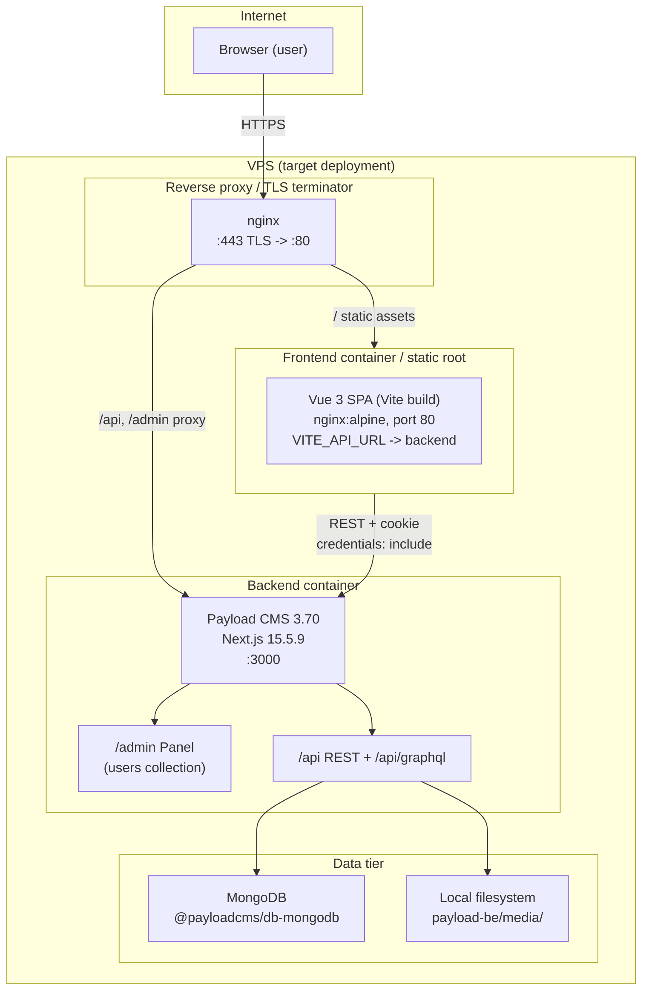
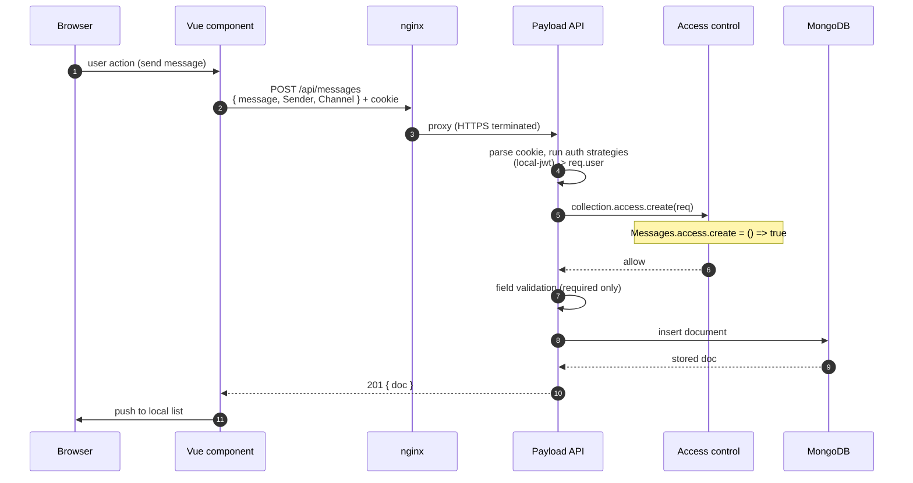
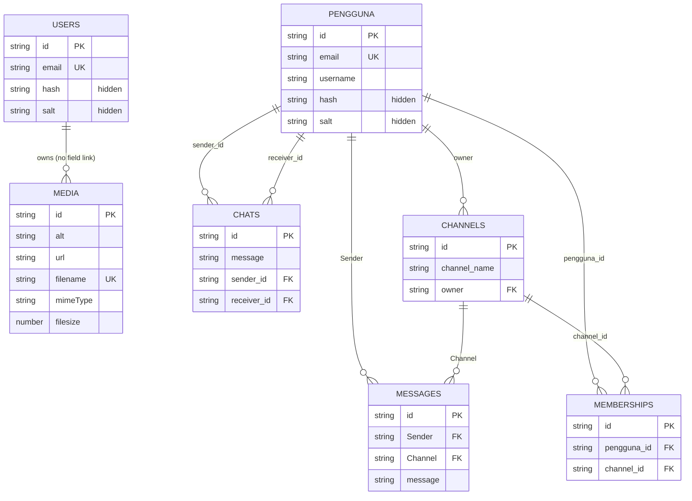

# Application Architecture — "Aplikasi Chat Sederhana"

> Scope: this document describes the application **as it exists today** in this repository.
> It is a reconstruction from source code, dependency manifests and Git history — not a design proposal.
> Findings about security posture live in [`security-audit.md`](./security-audit.md).

---

## 1. Application overview

A two-tier web chat application:

| Tier | Technology | Role |
|---|---|---|
| **Backend / CMS** | Payload CMS 3.92.1 on Next.js 16.4.3 (App Router) | REST API (GraphQL disabled), MongoDB persistence, Payload Admin Panel, local file uploads |
| **Frontend** | Vue 3.5.22 + Vite 7 (SPA) | User-facing chat UI (channels, direct messages, registration/login) |
| **Database** | MongoDB via `@payloadcms/db-mongodb` 3.92.1 (mongoose 8.24.1) | Document store for all 7 collections |

> **Current state note.** This document was reconstructed from the repository *as audited*
> (commit `1b33cc7`). The remediation in [`remediation-plan.md`](./remediation-plan.md) has since
> changed several behaviours described below — per-document authorization (Stage A), role-gated
> `users` (B3), disabled email verification and an added reset flow (B1), SPA route guards (B2),
> `GET /api/health` (B4), and paginated/backoff polling (B7). Where a paragraph below still
> describes the pre-remediation design, the audit's "Remediation applied" notes are authoritative.

The Vue SPA is a **pure API client**. It holds no session state of its own: authentication is entirely delegated to Payload's local auth strategy using an `HttpOnly` cookie, and every request is made with `credentials: 'include'`.

Two independent auth collections exist:

- `users` — Payload's admin-panel collection (`admin.user = Users.slug`). Carries a `roles` field (`admin` / `user`); only the `admin` role is treated as an administrator (B3).
- `penggunas` (Indonesian for "users") — the **application** collection used by the Vue SPA for registration, login, channels and messaging. Email verification is disabled (B1).

There is **no** real-time transport. "Live" messaging is implemented with polling via
`vue-frontend/src/utils/polling.js`: exponential backoff (3–4 s base → 30 s ceiling) that pauses
while the tab is hidden and refreshes on `visibilitychange` (B7). Message lists are paginated
(`limit=50`).

### Repository shape

This is a **single git repository containing two independent applications** — *not* a workspace/monorepo:

```
vue-chatapps-public/            <- git repo root (single branch: main, 6 commits)
├── payload-be/                  <- Payload CMS backend (npm lockfile, declares pnpm in engines)
└── vue-frontend/                <- Vue SPA (npm lockfile)
```

There is no root `package.json`, no workspace tooling, no shared dependency, and **no CI/CD configuration** anywhere in the repository.

---

## 2. Technology stack and detected versions

Versions below are read from the committed `package-lock.json` files (lockfileVersion 3), i.e. **the versions that would actually be installed**, not merely the declared ranges.

### Backend — `payload-be/`

| Package | Declared | Locked | Notes |
|---|---|---|---|
| `payload` | `3.70.0` | 3.70.0 | Core CMS/framework |
| `@payloadcms/next` | `3.70.0` | 3.70.0 | Next.js integration, REST/GraphQL route handlers |
| `@payloadcms/db-mongodb` | `3.70.0` | 3.70.0 | MongoDB adapter (mongoose) |
| `@payloadcms/ui` | `3.70.0` | 3.70.0 | Admin Panel |
| `@payloadcms/richtext-lexical` | `3.70.0` | 3.70.0 | Lexical editor (no richText field is actually used) |
| `@payloadcms/email-nodemailer` | `^3.70.0` | 3.70.0 | **Installed but never wired into the config** — no `email:` key in `payload.config.ts` |
| `@payloadcms/payload-cloud` | `3.70.0` | 3.70.0 | Plugin registered, but no cloud adapter configured |
| `next` | `15.5.9` | 15.5.9 | **20+ published advisories outstanding** (see security audit SEC-006) |
| `react` / `react-dom` | `^19.2.3` | — | Payload Admin Panel requires React 19 for 3.70 |
| `mongoose` | (transitive) | 8.15.1 | Behind `@payloadcms/db-mongodb` |
| `sharp` | `0.34.2` | 0.34.2 | Image processing; 3 libvips/libheif/librsvg advisories outstanding |
| `graphql` | `^16.8.1` | 16.12.0 | GraphQL API surface |
| `dompurify` | `^3.3.1` | 3.3.1 | **Unused** — no import anywhere in `src/` |
| `monaco-editor` | `^0.55.1` | 0.55.1 | **Unused** — no import anywhere in `src/` |
| `cross-env`, `dotenv` | — | — | Used by npm scripts / test setup |
| `yjs` | `^13.6.29` | — | Unused by application code (Payload internal dependency) |

Tooling: TypeScript 5.7.3, ESLint 9 + `eslint-config-next`, Prettier 3.4.2, Vitest 3.2.3 (integration), Playwright 1.57 (e2e).

Declared runtime (`payload-be/package.json` → `engines`): `node ^18.20.2 || >=20.9.0`, `pnpm ^9 || ^10`.
**Inconsistency:** the committed lockfile is `package-lock.json` (npm), and `pnpm-lock.yaml` is absent. The Docker Compose command runs `pnpm install`, which will resolve fresh versions rather than honouring the committed lockfile.

### Frontend — `vue-frontend/`

| Package | Declared | Locked | Notes |
|---|---|---|---|
| `vue` | `^3.5.22` | 3.5.22 | SPA framework |
| `vue-router` | `^4.6.3` | 4.6.3 | History-mode routing |
| `pinia` | `^3.0.3` | 3.0.3 | **Only the unused `counter` demo store exists** |
| `qs` | `^6.14.0` | 6.14.0 | Query-string builder for Payload `where` clauses |
| `vite` | `^7.1.11` | 7.1.12 | Build tool; dev-server advisories apply to dev only |
| `@vitejs/plugin-vue` | `^6.0.1` | 6.0.1 | |

Tooling: ESLint 9 + `eslint-plugin-vue` + `oxlint`, Prettier 3.6.2, `npm-run-all2`.

Declared runtime: `node ^20.19.0 || >=22.12.0`.

### Runtime environment observed

`node v22.18.0`, `npm 10.9.3`, Docker 28.5.1 available. `pnpm` is **not** installed on the audit host. Neither `node_modules` directory was present at the start of the audit.

---

## 3. Repository structure

### Backend (`payload-be/`)

```
payload-be/
├── src/
│   ├── payload.config.ts        # Payload configuration (CORS, CSRF, collections, db, plugins)
│   ├── payload-types.ts         # Auto-generated by Payload — DO NOT EDIT
│   ├── app/
│   │   ├── (frontend)/          # Next.js route group: template landing page
│   │   │   ├── page.tsx         # "Welcome to your new project." template page
│   │   │   ├── layout.tsx
│   │   │   └── styles.css
│   │   ├── (payload)/           # Route group mounting the Payload Admin Panel + API
│   │   │   ├── layout.tsx       # RootLayout + server functions
│   │   │   ├── custom.scss      # empty
│   │   │   ├── admin/[[...segments]]/page.tsx   # Admin Panel UI (generated)
│   │   │   └── api/
│   │   │       ├── [...slug]/route.ts   # REST: GET/POST/PATCH/PUT/DELETE/OPTIONS (generated)
│   │   │       ├── graphql/route.ts      # POST /api/graphql
│   │   │       └── graphql-playground/route.ts
│   │   ├── my-route/route.ts    # Unmodified Payload template example route (GET)
│   │   └── (payload)/admin/importMap.js
│   └── collections/             # ← the entire domain model (7 files)
│       ├── Users.ts             # admin auth collection
│       ├── Penggunas.ts         # application auth collection
│       ├── Media.ts             # upload collection
│       ├── Chats.ts             # direct messages
│       ├── Channels.ts          # channels
│       ├── Memberships.ts       # channel membership join
│       └── Messages.ts          # channel messages
├── tests/
│   ├── int/api.int.spec.ts      # vitest — one smoke test ("fetches users")
│   └── e2e/frontend.e2e.spec.ts # playwright — asserts the Payload template homepage
├── next.config.mjs              # withPayload() wrapper + webpack extension aliases
├── vitest.config.mts            # jsdom, include tests/int/**/*.int.spec.ts
├── playwright.config.ts         # webServer: `pnpm dev` on :3000
├── tsconfig.json                # paths: @/* -> ./src/*, @payload-config -> ./src/payload.config.ts
├── eslint.config.mjs, .prettierrc.json
├── Dockerfile                   # node:20-alpine, multi-stage-less, USER app
├── docker-compose.yml           # payload (node:18-alpine) + mongo:latest
├── .env.example                 # DATABASE_URI, PAYLOAD_SECRET (placeholders only)
├── .npmrc                       # legacy-peer-deps=true
├── .yarnrc                      # --install.ignore-engines true
└── package.json / package-lock.json
```

Files marked "generated" are rewritten by `payload generate:importmap` / `payload generate:types`; they are not application source.

### Frontend (`vue-frontend/`)

```
vue-frontend/
├── src/
│   ├── main.js                  # createApp + Pinia + Router
│   ├── App.vue                  # <RouterView/> only
│   ├── env.d.ts
│   ├── router/index.js          # 10 routes, no guards
│   ├── stores/counter.js        # unused Pinia demo store
│   ├── components/
│   │   ├── Login.vue            # register/login forms
│   │   ├── Register.vue
│   │   ├── Dashboard.vue        # main app shell: channels, user list, create/join
│   │   ├── Chat.vue             # direct-message view
│   │   ├── ChannelChatroom.vue  # channel message view (current, used by /channel/:id)
│   │   ├── Channel.vue          # legacy/unused channel view (stale field names)
│   │   ├── Browse.vue           # legacy/unused user browser (hardcoded localhost URL)
│   │   ├── CreateChannel.vue    # legacy/unused create form
│   │   ├── HelloWorld.vue, TheWelcome.vue, WelcomeItem.vue, icons/  # template leftovers
│   └── assets/                  # main.css, base.css, main_old.css, logo.svg
├── public/favicon.ico
├── index.html                   # title: "Aplikasi Chat Sederhana"
├── vite.config.js               # @ alias -> ./src, outDir: dist
├── eslint.config.js, .prettierrc.json, .editorconfig, .gitattributes
├── Dockerfile                   # node:20-alpine build -> nginx:alpine
├── default.conf                 # nginx vhost (HTTP only)
└── package.json / package-lock.json
```

**Dead code:** `Browse.vue`, `CreateChannel.vue`, `Channel.vue`, `TheWelcome.vue`, `WelcomeItem.vue`, `HelloWorld.vue`, `stores/counter.js` are not reachable from any route that the SPA actually uses for the chat product. `BrowseView.vue` / `CreateChannelView.vue` do exist as routes and do import them.

### Generated / non-source artifacts

- `payload-be/src/payload-types.ts` — Payload-generated TypeScript interfaces.
- `payload-be/src/app/(payload)/admin/**` and `api/**` route files — Payload-generated.
- `payload-be/src/app/(payload)/admin/importMap.js` — Payload-generated.
- `payload-be/.next/` (build output, gitignored), `vue-frontend/dist/` (build output, gitignored).
- `payload-be/media/` — local upload directory, gitignored.

---

## 4. Component responsibilities

| Component | Responsibility | Notes |
|---|---|---|
| `payload-be/src/payload.config.ts` | Root Payload config: collections, Mongo adapter, CORS/CSRF allow-lists, secret, sharp, plugins | Single source of server-side truth |
| `payload-be/src/collections/*` | The entire domain model and **all** authorization policy | Only 7 small files; no hooks, no custom endpoints, no validation beyond field `required` |
| `payload-be/src/app/(payload)/api/[...slug]/route.ts` | Exposes Payload's full REST API | Generated |
| `payload-be/src/app/(payload)/api/graphql/route.ts` | Exposes Payload's full GraphQL API | Generated. Playground is disabled in production by Payload default |
| `payload-be/src/app/(payload)/admin/**` | Payload Admin Panel at `/admin` | Generated; `admin.user = users` |
| `payload-be/src/app/(frontend)/page.tsx` | **Unmodified Payload template landing page** at `/` | Ships the "Welcome to your new project." text and a link to the admin panel |
| `payload-be/src/app/my-route/route.ts` | Unmodified template example route | Returns a static JSON string; no auth |
| `vue-frontend/src/router/index.js` | Route table | Global `beforeEach` guard; `meta.public` routes (B2) |
| `vue-frontend/src/utils/polling.js` | Shared polling helper | Exponential backoff + visibility pause (B7) |
| `vue-frontend/src/views/ForgotPasswordView.vue` / `ResetPasswordView.vue` | Password reset | Public routes (B1) |
| `vue-frontend/src/components/Dashboard.vue` | App shell: profile, channel list, search-based user finder, create/join channel, logout | The de-facto landing page after login (SEC-013) |
| `vue-frontend/src/components/Chat.vue` | Direct messages (1:1) | Backoff polling (4 s base) + pagination |
| `vue-frontend/src/components/ChannelChatroom.vue` | Channel messages + channel list + create/join | Backoff polling (3 s base) + pagination |
| `vue-frontend/src/components/Login.vue` / `Register.vue` | Credentials → `penggunas` collection | `credentials: 'include'` |
| `vue-frontend/src/stores/counter.js` | Pinia demo store | Unused |
| `payload-be/Dockerfile` | Container image for the backend | Single stage; `EXPOSE 50010` does not match the app's real port |
| `vue-frontend/Dockerfile` | Container image: Vite build → nginx:alpine | Serves `dist/` on port 80 |
| `vue-frontend/default.conf` | nginx vhost for the SPA | HTTP only, no security headers |

---

## 5. Architecture diagram



### Component diagram — request flow with trust boundaries



**Trust-boundary note:** the diagram above shows the *current* behaviour. The critical gap is that step 2 — the sender identity is taken from the **request body**, not from `req.user`. See SEC-005.

---

## 6. Authentication flow

Payload's local strategy with `useSessions: true` (the default).

```mermaid
sequenceDiagram
    autonumber
    participant B as Browser
    participant P as Payload API
    participant D as MongoDB

    B->>P: POST /api/penggunas/login { email, password }
    P->>D: find_one penggunas by email
    D-->>P: doc (hash, salt)
    P->>P: PBKDF2-SHA256(password, salt, 25000, 512) + timing-safe scmp
    Note over P: mismatch -> 401 "The email or password provided is incorrect."
    P->>P: sign JWT { collection, id, sid, exp }
    P->>D: append session { id, expiresAt } to user doc
    P-->>B: Set-Cookie: payload-token=...; HttpOnly; Path=/; SameSite=Lax; Max-Age=7200
    Note over P: Secure flag NOT set (config default secure:false)

    B->>P: GET /api/penggunas/me (cookie)
    P->>P: verify JWT (jose), confirm session id still present
    P-->>B: 200 { user: { id, email, username, ... } }
```

### Verified auth characteristics (Payload 3.92.1)

| Property | Value | Source |
|---|---|---|
| Strategy | Local (PBKDF2) + session-backed JWT | `auth/strategies/local/authenticate.ts` |
| Password hash | `pbkdf2(password, salt, 25000, 512, 'sha256')`, random 32-byte salt | `auth/strategies/local/generatePasswordSaltHash.ts` |
| Comparison | `scmp` (constant-time) | `auth/strategies/local/authenticate.ts` |
| Token lifetime | 7 days (`tokenExpiration` set on `penggunas`) | `Penggunas.ts` |
| Cookie | `HttpOnly`, `Path=/`, `SameSite=Lax`, `Secure` (via `COOKIE_SECURE`) | `Penggunas.ts` / `Users.ts` `auth.cookies` |
| Sessions | `useSessions: true` → session id embedded in JWT and stored on the user document; session missing ⇒ JWT rejected | `auth/strategies/jwt.ts` |
| Login lockout | `maxLoginAttempts: 5`, `lockTime: 600000` ms | `Penggunas.ts` `auth` |
| Email verification | **disabled** (`verify: false`) — deliberate (B1) | `Penggunas.ts` |
| Password reset | `auth.forgotPassword` builds an SPA link; email is sent when `SMTP_*` is configured, otherwise the link is printed to the server console in non-production | `Penggunas.ts` + `config/email.ts` |
| Admin roles | `users.roles` (`admin` / `user`); `isAdmin` requires `admin` | `Users.ts` + `access/index.ts` |
| JWT secret | derived from `PAYLOAD_SECRET` via SHA-256, truncated to 32 chars | `payload/src/index.js` → `this.secret` |
| Username login | disabled (`loginWithUsername: false`) | `authDefaults` |

### Sessions in the SPA

The Vue app never reads the token. Every call uses `credentials: 'include'` so the browser attaches the `HttpOnly` cookie automatically. **No token is stored in `localStorage` or `sessionStorage`** — verified by searching the whole `src/` tree (zero matches).

---

## 7. Message lifecycle

There are **two independent messaging systems** with different data shapes.

### 7.1 Direct messages — `chats` collection

```
Collection: chats
  message      : text
  sender_id    : relationship -> penggunas (hasMany: false)
  receiver_id  : relationship -> penggunas (hasMany: false)
Access: create = () => true ; read = Payload default (Boolean(req.user)) ;
        update/delete = Payload default (Boolean(req.user))
```

Full path for **sending** a DM (`vue-frontend/src/components/Chat.vue:141`):

1. `sendMessage()` reads `messageInput`, `me_id` (from `GET /api/penggunas/me`), `user_id` (from the route).
2. `POST {VITE_API_URL}/api/chats` with body `{ sender_id, receiver_id, message }` and `credentials: 'include'`.
3. nginx proxies to Payload.
4. Payload authenticates the cookie → `req.user` (the *real* identity).
5. `chats.access.create` → `() => true` → **allowed for anyone, including anonymous**.
6. `sender_id` is taken **verbatim from the body**. `req.user` is never consulted for the sender field.
7. Mongo insert.
8. Response `{ doc }`; the SPA pushes the returned doc into its local `messages` array.

Full path for **reading** DMs (`Chat.vue:103`):

1. Every 4 s the SPA issues `GET /api/chats?where[or][0][and][0][sender_id][equals]=<me>&...`.
2. `chats.access.read` falls back to Payload's default → `Boolean(req.user)` → **any authenticated user** passes.
3. The `where` clause is **client-supplied**; the server applies no ownership filter of its own.
4. Payload returns matching docs, sorted client-side by `createdAt`.

> Consequence: the confidentiality of direct messages is enforced **only** by the `where` clause that the client chooses to send. A user who changes the query — or simply asks for the whole collection — receives every DM in the system. Documented as SEC-002.

### 7.2 Channel messages — `messages` collection

```
Collection: messages
  Sender   : relationship -> penggunas (required)
  Channel  : relationship -> channels   (required)
  message  : text (required)
Access: read = () => true ; create = () => true
        update/delete = Payload default (Boolean(req.user))
```

Send path (`vue-frontend/src/components/ChannelChatroom.vue:89`): identical shape — `POST /api/messages` with `{ message, Sender: userId, Channel: channelId }`. `Sender` comes from the client, not from `req.user`.

Read path (`ChannelChatroom.vue:67`): `GET /api/messages?where[Channel][equals]=<channelId>&sort=createdAt&depth=1`, polled every 3 s. `messages.access.read = () => true` ⇒ **anonymous**.

### 7.3 Membership and channel lifecycle

```
Collection: memberships   pengguna_id -> penggunas, channel_id -> channels
Access: read = () => true ; create = () => true ; delete = () => true
```

- **Join**: `POST /api/memberships { pengguna_id, channel_id }` — the joining user id is client-supplied.
- **Auto-join on create**: after creating a channel, the SPA immediately POSTs a membership for itself.
- **Visibility**: `ChannelChatroom.vue` shows the message composer only when `isJoined` is true (`data.docs.length > 0` from a client-side membership query). This is a **UI-only** control — the backend does not require membership to read or write messages.
- **Leave**: the UI has no leave button, but `DELETE /api/memberships/:id` is permitted for any caller.

### 7.4 Message editing and deletion

**Not implemented in the UI and not explicitly authorised in the collections.** `messages` and `chats` do not declare `update`/`delete` access, so both fall back to Payload's default `Boolean(req.user)` — i.e. **any authenticated user can edit or delete any message**, provided they know the document id. There is no ownership check and no editor UI. Documented as SEC-003.

---

## 8. Data model



### Collection inventory

| Collection | Purpose | Key fields | Relationships | Declared access | Effective access (Payload 3.70 defaults) |
|---|---|---|---|---|---|
| `users` | Payload Admin Panel accounts | `email` (unique), `hash`, `salt` | — | `auth: true`, no `access` block | create/read/update/delete → `Boolean(req.user)` |
| `penggunas` | Application accounts | `email` (unique), `username` (**not unique**), `hash`, `salt` | — | `create/read/update = () => true` | **anonymous** create/read/update; delete → `Boolean(req.user)` |
| `media` | File uploads | `alt` (required), + generated upload fields | — | `read = () => true` | **anonymous** read; create/update/delete → `Boolean(req.user)` |
| `chats` | 1:1 direct messages | `message`, `sender_id`, `receiver_id` | → `penggunas` ×2 | `create = () => true` | create **anonymous**; read/update/delete → `Boolean(req.user)` |
| `channels` | Chat rooms | `channel_name` (required), `owner` (required) | → `penggunas` | `read/create/update/delete = () => true` | **all four anonymous** |
| `memberships` | User ↔ channel join | `pengguna_id`, `channel_id` | → `penggunas`, `channels` | `read/create/delete = () => true` | **all three anonymous** |
| `messages` | Channel messages | `Sender`, `Channel`, `message` (all required) | → `penggunas`, `channels` | `read/create = () => true` | **read anonymous**; update/delete → `Boolean(req.user)` |

**Payload's default access control** (from `packages/payload/src/auth/defaultAccess.js`):

```js
const defaultAccess = ({ req: { user } }) => Boolean(user)
```

Any operation whose `access` key is not overridden falls back to this. It is a **presence** check only — it carries no notion of ownership, membership or role.

### Field-level access control

**There is none.** No collection in `payload-be/src/collections/` declares a field-level `access` block. Consequences (all verified against the Payload 3.70 source):

- The `email` and `username` fields of `penggunas` are readable and writable by anyone who can reach the collection.
- The `password` field is not declared in the collection at all; Payload's `updateDocument` reads `data.password` directly from the request body and replaces it with a freshly computed `hash`/`salt` (`packages/payload/src/collections/operations/utilities/update.ts`). Combined with `penggunas.access.update = () => true`, **any caller can set a new password for any `penggunas` document** without knowing the current one. This is the root cause of SEC-001.
- `hash` and `salt` are `hidden: true`, which removes them from *responses* but does not by itself prevent them from being *written*.

### Files and storage

`media` is an upload collection with `upload: true` and **no `mimeTypes` restriction**, **no `filesize` limit**, and **no `imageSizes`**. Files are written to the local filesystem under `payload-be/media/` and served through `GET /api/media/file/:filename`. `Media.access.read = () => true` ⇒ **anonymous download of every uploaded file**. `sharp` is wired into the config, so image processing (resize/crop) is active for uploads that Payload recognises as images.

---

## 9. API communication flow

### Endpoints consumed by the SPA

| Endpoint | Method | Called from | Collection |
|---|---|---|---|
| `/api/penggunas` | POST | `Register.vue:64` | create account |
| `/api/penggunas/login` | POST | `Login.vue:52` | login |
| `/api/penggunas/logout` | POST | `Dashboard.vue:131` | logout |
| `/api/penggunas/me` | GET | `Chat.vue:127`, `ChannelChatroom.vue:30`, `Dashboard.vue:142` | current user |
| `/api/penggunas/directory` | GET | `Dashboard.vue`, `Browse.vue` | search users (`?q=` ≥ 2 chars, paginated, no email) (SEC-013) |
| `/api/penggunas/:id` | GET | `Chat.vue:122` | single user |
| `/api/chats` | GET / POST | `Chat.vue:103`, `Chat.vue:141` | direct messages |
| `/api/channels` | GET / POST | `Dashboard.vue:163/185`, `ChannelChatroom.vue:39/128` | channels |
| `/api/channels/:id` | GET / PATCH | `Channel.vue:52`, `Channel.vue:215` | channel detail / rename |
| `/api/memberships` | GET / POST / DELETE | `Dashboard.vue:176/198/214`, `ChannelChatroom.vue:57/111/143` | membership |
| `/api/messages` | GET / POST | `ChannelChatroom.vue:67/89`, `Channel.vue:150/182` | channel messages |

### Additional endpoints exposed by the backend that the SPA does not use

| Endpoint | Method | Notes |
|---|---|---|
| `/api/graphql` | POST | Full GraphQL API. **Exposes the same data through a second interface** — every collection-level access-control finding applies to GraphQL as well. Query complexity is capped at 1000 by Payload default. |
| `/api/graphql-playground` | GET | Disabled in production by Payload default (`disablePlaygroundInProduction: true`) |
| `/api/access` | GET | Access reflection endpoint (used by the Admin Panel) |
| `/api/users/...`, `/api/media/...` | * | Full REST surface for the admin collection and uploads |
| `/admin` | * | Full Payload Admin Panel |
| `/my-route` | GET | Unmodified template example route, no auth, returns a static string |
| `/` | GET | Unmodified template landing page, links to `/admin` |
| `/api/penggunas/first-register` | POST | **Creates the first `pengunas` account if none exists** — see SEC-007 (RCE advisory reachability) |
| `/api/penggunas/forgot-password` | POST | Present, but **no email adapter is configured**, so the reset token is printed to the server log rather than emailed |

### CORS and CSRF

Configured in `payload-be/src/payload.config.ts:28-37`:

```ts
cors:  ['http://103.103.21.102:50011', 'http://localhost:50011', 'http://localhost:5173'],
csrf:  ['http://103.103.21.102:50011', 'http://localhost:50011', 'http://localhost:5173'],
```

Payload's CORS middleware (`packages/payload/src/utilities/headersWithCors.ts`) sets `Access-Control-Allow-Credentials: true` and echoes the `Origin` for any origin on the allow-list, and sets `Access-Control-Allow-Origin: *` for the wildcard case. The current list contains a **plain-HTTP public IP** (`103.103.21.102:50011`) — see SEC-008.

`serverURL` is **not** set in the config, so `config.csrf` never receives the production origin automatically (`packages/payload/src/config/sanitize.js`).

### Pagination, limits and validation

- `defaultMaxTextLength` = 40000 (Payload default) — a single message may be up to 40 000 characters.
- `defaultDepth` = 2, `maxDepth` = 10.
- The SPA does **not** send `limit` or `page` on any list query, so Payload's default limit of 10 applies to `find` — but the SPA's DM query and the message query both rely on client-side sorting of the returned page, which means long conversations are silently truncated rather than paged.
- No field in any collection declares `validate`; only `required: true` is used.
- No `beforeValidate` / `beforeChange` / `afterRead` / `afterChange` hooks exist anywhere in the codebase.

---

## 10. File upload flow

```
Client  : multipart/form-data POST /api/media
            ├─ 'alt'    : text (required)
            └─ 'file'   : binary
Payload : generateFileData()
            ├─ fileTypeFromBuffer()          → real content sniffing (not just the client MIME)
            ├─ checkFileRestrictions()       → blocks exe/dll/bat/php/js/asp/... (RESTRICTED_FILE_EXT_AND_TYPES)
            ├─ validateMimeType()            → strictly enforces raster allow-list: png, jpeg, webp, gif (SEC-004)
            ├─ beforeOperation hook          → enforces 5 MB cap (413 PayloadTooLargeError)
            ├─ beforeValidate hook           → binds uploadedBy to req.user.id
            ├─ getSafeFileName()             → sanitize-filename + uniqueness loop
            └─ sharp                         → image processing (crop/focalPoint disabled)
Storage : local filesystem, payload-be/media/
Serve   : GET /api/media/file/:filename   → Media.access.read = ({ req: { user } }) => Boolean(user)
                                            + modifyResponseHeaders: nosniff, sandbox CSP, no-store
                                            + isolated media origin deployment (media.example.com)
```

**Remediation applied (SEC-004):** Uploads are strictly restricted to raster image MIME types (`image/png`, `image/jpeg`, `image/webp`, `image/gif`). Dangerous vectors (SVG, HTML, XML, PDF, scripts) are rejected. Features enabling SSRF (`pasteURL`) or bulk uploads are disabled. Upload sizes are hard-capped at 5 MB. All operations require an authenticated session (`uploadedBy` is bound to `req.user.id`). Media responses deliver defensive headers (`nosniff`, `sandbox` CSP, `no-store`, `Content-Disposition: attachment` for non-raster fallbacks). Isolated media host proxy configuration (`payload-be/nginx/media-origin.conf`) is provided to isolate execution from the primary application origin.

---

## 11. Error handling and logging

- **Backend**: Payload's default error handling. Non-public errors are replaced with a generic message; the original is logged server-side via Pino. `config.debug` is not enabled.
- **Frontend**: every API call is wrapped in `try/catch`. Failures surface via `alert(error.message)` or `console.error`. Several components (`Browse.vue`, `CreateChannel.vue`, `Channel.vue`) reference an undefined `req` in their error paths (`(await req.json())`), which would throw a `ReferenceError` instead of showing the API error.
- **Logging**: Payload's Pino logger writes to stdout. `docker-compose.yml` now uses the bounded `json-file` log driver (`max-size`/`max-file`) for both services instead of `driver: none`. There is no log shipping and no request-ID correlation.
- **Monitoring**: `GET /api/health` performs a DB round-trip and drives the container healthchecks. No off-host log shipping, metrics or alerting yet (B4, partly deferred).

---

## 12. External services and integrations

| Service | Status | Notes |
|---|---|---|
| MongoDB | **Required** | `DATABASE_URI` env var; `mongooseAdapter` |
| SMTP / email | **Configured when `SMTP_*` is set** | `payload.config.ts` wires `buildEmailAdapter()` (`@payloadcms/email-nodemailer`). When `SMTP_HOST` is empty, Payload logs outbound mail; the password-reset link is also printed to the server console in non-production (B1). Email verification is disabled. |
| Payload Cloud | **Configured but inert** | `payloadCloudPlugin()` is registered; no cloud storage adapter is attached, so uploads stay on local disk |
| Sharp | **Active** | Image processing on upload |
| Lexical editor | Configured, unused | No `richText` field exists in any collection |
| External HTTP calls | **None** | No outbound API calls in application code |
| Telemetry | **Enabled** | Payload's anonymous telemetry (`telemetry: true` default) is not opted out |

---

## 13. Deployment assumptions baked into the repository

The repository contains two container definitions and one nginx vhost. They encode **development-era assumptions** and are not production-ready (details in [`deployment-guide.md`](./deployment-guide.md)).

| Assumption | Where | Reality check |
|---|---|---|
| Frontend is served by nginx on port 80, mapped to host port 50011 | `vue-frontend/Dockerfile:25`, `default.conf` | HTTP only, no TLS, no security headers, `server_name _` |
| Backend listens on 3000 in dev, 50010 in the image | `docker-compose.yml:7`, `payload-be/Dockerfile:12` | `EXPOSE 50010` matches nothing; Next.js defaults to 3000 |
| MongoDB is reachable on the network and published to the host | `docker-compose.yml:23` | `27017:27017` published to **0.0.0.0** |
| `pnpm` is the package manager | `package.json` engines, `docker-compose.yml:12` | The committed lockfile is npm's `package-lock.json`; `pnpm install` would ignore it |
| The frontend reaches the backend at a hardcoded origin | `payload.config.ts:29` | `http://103.103.21.102:50011` — plain HTTP, a public IP, hardcoded into source |
| `DATABASE_URI` and `PAYLOAD_SECRET` come from `.env` | `payload-be/.env.example` | `.env` is gitignored (good); **no `.dockerignore` exists**, so `COPY . .` would bake a local `.env` into the image |
| Node 18 / 20 | `docker-compose.yml:5` (`node:18-alpine`), both Dockerfiles (`node:20-alpine`) | Backend `engines` allow `^18.20.2 || >=20.9.0`; frontend requires `^20.19.0 || >=22.12.0` |

---

## 14. Known architectural limitations

> **Superseded in part (2026-10-30).** Items 1, 2, 5, 6, 7, 11 and 12 have been addressed by the
> Stage A remediation and Stage B work; they are retained here as the audited as-found state,
> with the current status noted inline. Items 3, 4, 8, 9 and 10 remain open (Stages B7 / C).

1. ~~**No authorization model.**~~ **Resolved (Stage A).** Per-document access control is
   implemented across all 7 collections, with role-gated `users` (B3).
2. ~~**Identity is client-asserted.**~~ **Resolved (A2).** `sender_id`, `Sender`, `pengguna_id`
   and `owner` are derived from `req.user` in `beforeChange` hooks and are immutable.
3. **No real-time layer.** Polling per open view; each tab now backs off exponentially
   (3–4 s → 30 s) and stops while hidden, but the view is still stale by design (Stage C5).
4. ~~**No pagination in the UI.**~~ **Resolved (B7).** Message lists fetch `limit=50&page=n`
   with a "Load older messages" control.
5. ~~**No rate limiting, at any layer.**~~ **Resolved (A8).** Edge `limit_req`/`limit_conn`
   zones in the nginx vhost.
6. ~~**No input validation.**~~ **Resolved (A6).** Username pattern + uniqueness, 8-character
   password minimum, `defaultMaxTextLength` of 2000.
7. **No email delivery by default.** Password reset is implemented (B1) and works when `SMTP_*`
   is configured; otherwise the reset link is printed to the server console in non-production.
   Email verification is disabled by design.
8. **Two parallel messaging models** (`chats` and `messages`) with different field names,
   different clients, and different access rules — a recurring source of divergence (Stage C4).
9. **Dead and duplicated UI.** Several legacy components remain and post obsolete payload
   shapes (Stage C1).
10. **Template residue shipped to production.** `/` serves the Payload template page and
    `/my-route` is still present (Stage C3).
11. ~~**No automated tests of substance.**~~ **Resolved.** 80 integration tests cover the
    authorization matrix, registration policy, uploads and password reset; the e2e test asserts
    the SPA mounts.
12. ~~**No CI/CD, no health check endpoint, no metrics …**~~ **Partly resolved.** `GET /api/health`
    (DB round-trip) and container healthchecks exist (B4). CI (B6) and backups (B5) are
    deferred; off-host log shipping and alerting are deferred.
13. **Payload Admin Panel is the only CMS surface** and its collection list is the raw domain model with no meaningful access control behind it.
